# Laboratoire Active Directory · IAM · PAM · Sécurité Cloud

Laboratoire d'apprentissage construit de zéro sur VMware Workstation, couvrant l'administration
Active Directory, l'automatisation PowerShell, la gestion des identités (IAM), la gestion des accès
à privilèges (PAM) et la sécurité cloud.

L'ensemble a été mené en douze modules progressifs. Chaque module se conclut par une vérification
automatisée : une configuration n'est validée que lorsqu'elle passe ses contrôles. Ce document
présente, module par module, ce qui a été réalisé, les concepts sous-jacents, les difficultés
rencontrées et les preuves de bon fonctionnement.

---

## Architecture

| Machine | Système | Adresse | Rôle |
|---|---|---|---|
| **DC01** | Windows Server 2025 | 192.168.56.10 | Contrôleur de domaine, DNS, sauvegarde |
| **DC02** | Windows Server 2025 | 192.168.56.11 | Second contrôleur, réplication, FSMO |
| **WKS01** | Windows 11 | 192.168.56.50 | Poste client joint au domaine |
| **LNX01** | Ubuntu Server 24.04 | 192.168.56.30 | Docker : Keycloak, Vault, PostgreSQL |

Deux réseaux virtuels : **VMnet1** (host-only, DHCP désactivé, `192.168.56.0/24`) porte le domaine
isolé ; **VMnet8** (NAT) fournit l'accès Internet à la machine Linux. Le DHCP est désactivé parce
qu'un contrôleur de domaine exige une adresse fixe et doit être serveur DNS de lui-même.

Domaine : `corp.atlas.lab` (NetBIOS `ATLAS`), niveau fonctionnel Windows Server 2016.

---

## Module 1 — Le domaine Active Directory

**Objectif.** Transformer un serveur nu en contrôleur de domaine, c'est-à-dire créer l'annuaire qui
gérera toutes les identités. Un contrôleur de domaine authentifie les utilisateurs, stocke
l'annuaire et héberge le DNS du domaine.

Après avoir donné au serveur une adresse fixe et l'avoir réglé pour interroger son propre DNS, on le
promeut contrôleur de domaine d'une nouvelle forêt. Les avertissements jaunes visibles concernent
l'absence de zone DNS parente `.lab` : ils sont normaux et sans conséquence.

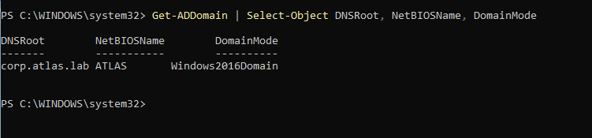

Une fois le domaine créé, on vérifie que le DNS contient bien les enregistrements du domaine. Un
contrôleur de domaine pointe son DNS sur lui-même : il est l'autorité pour la zone, qu'un serveur
externe ne connaîtrait pas.

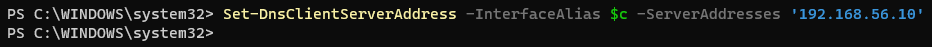

Le mot de passe DSRM, défini à la promotion, correspond à un compte administrateur local utilisé
uniquement pour démarrer le contrôleur en mode restauration.

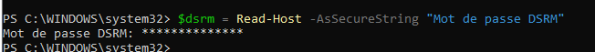

Le poste Windows 11 rejoint ensuite le domaine. Son DNS doit pointer sur le contrôleur, sans quoi il
ne trouverait aucun serveur d'ouverture de session.

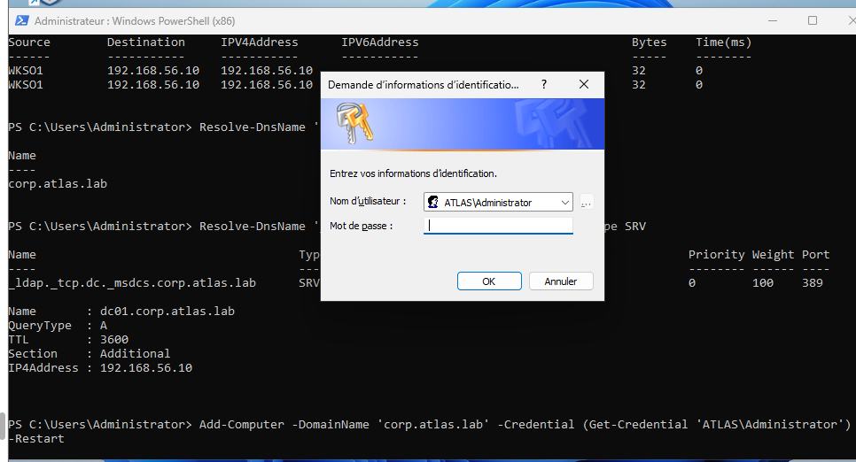

Côté serveur, le poste apparaît bien dans l'unité d'organisation des postes.

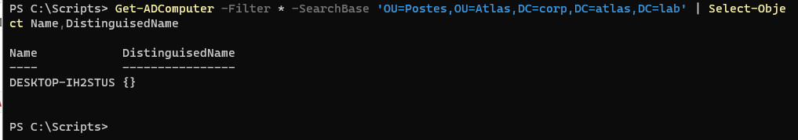

> **Difficultés rencontrées.**
> - L'installation de Windows Server échouait à des pourcentages variables : des partitions
>   résiduelles, la fonction « Easy Install » de VMware et la lecture de l'ISO depuis un disque
>   externe se cumulaient. Correction : nettoyer le disque, retirer la disquette virtuelle, copier
>   l'ISO en local.
> - La promotion échouait avec « prerequisites failed » : le compte administrateur local n'avait pas
>   de mot de passe, or ce compte devient l'administrateur du domaine. Définir le mot de passe a
>   débloqué l'opération.
> - Une première jonction a échoué (« déjà dans le domaine ») à cause d'un objet résiduel d'un lab
>   antérieur. Un domaine est identifié par son SID, pas par son nom : il a fallu sortir la machine
>   puis la rejoindre proprement.

---

## Module 2 — Structuration du domaine

**Objectif.** Organiser le domaine : unités d'organisation, groupes selon le modèle AGDLP,
délégation, stratégies de groupe.

Une **unité d'organisation** sert à organiser et déléguer ; un **groupe** sert à attribuer des
permissions. L'arborescence est créée par un script idempotent — chaque OU est créée (en vert) ou
signalée existante (en gris), ce qui rend le script relançable sans risque.

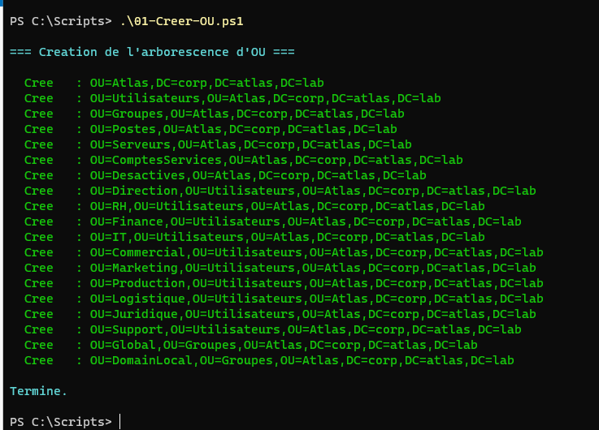

Le résultat : une OU racine `Atlas` contenant les départements, les groupes, les postes et les
serveurs.

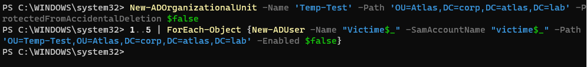

**Le modèle AGDLP.** Un compte va dans un groupe global (par fonction), membre d'un groupe de
domaine local (par ressource), qui reçoit la permission. On crée dix groupes globaux `GG-` et vingt
groupes de domaine local `DL-`.

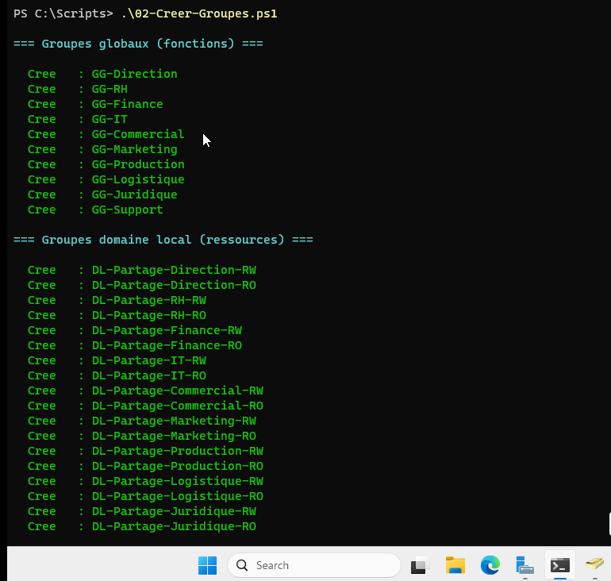

La vérification confirme qu'un groupe de ressource contient bien un groupe de fonction (classe
« group ») : AGDLP est respecté. Si l'on voyait un utilisateur ici, la règle serait violée.

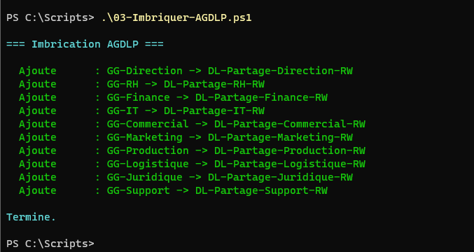

**Délégation.** Plutôt que de faire du support un administrateur du domaine, on lui délègue
précisément la réinitialisation des mots de passe.

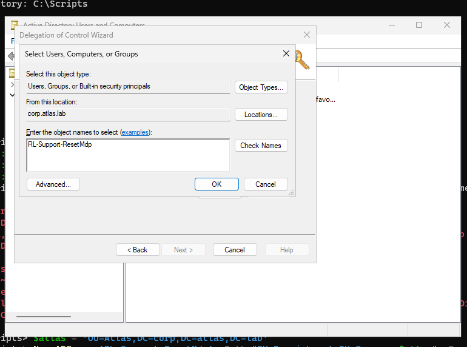

La vérification par les ACL de l'OU confirme la délégation, sous forme d'un droit étendu.

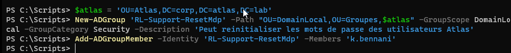

**Redirection des conteneurs.** Les conteneurs par défaut sont des conteneurs (`CN`), non des OU :
on ne peut pas leur lier de stratégie, et les machines qui y atterrissent échappent aux GPO.

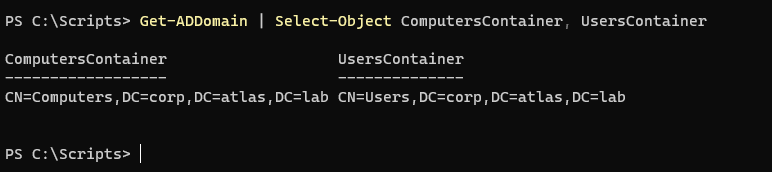

Les commandes `redircmp` et `redirusr` corrigent ce point en redirigeant vers les OU gérées.

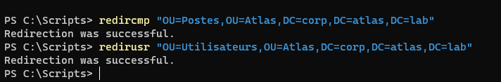

Une stratégie de groupe de base est créée et liée, puis vérifiée sur le poste client.

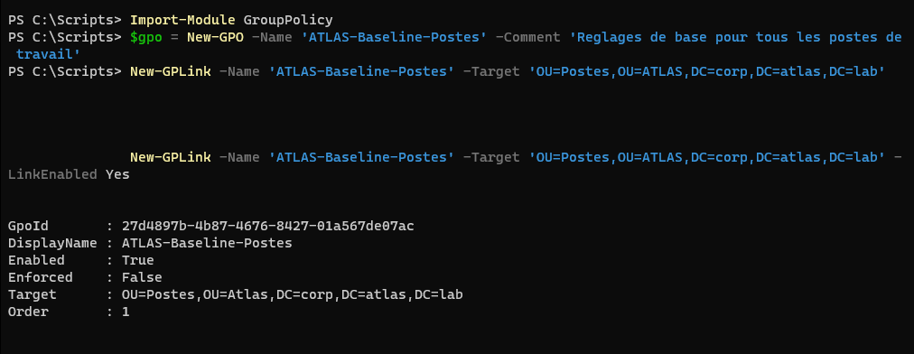

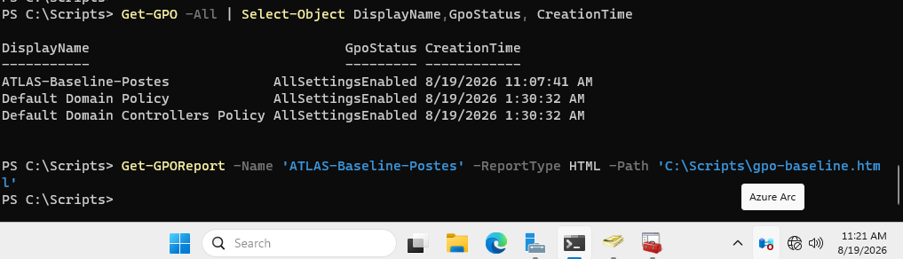

Le module est validé par quatorze contrôles : nombre d'OU, portées des groupes, respect d'AGDLP,
redirection, délégation, présence de la GPO.

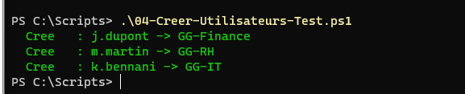

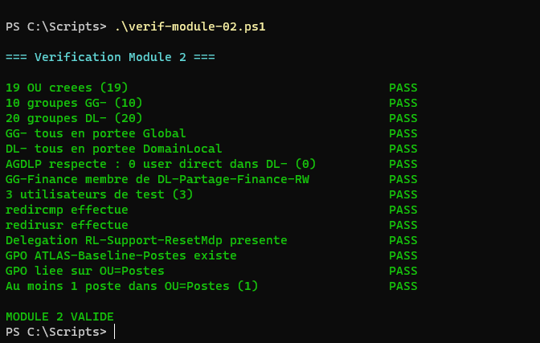

Deux exercices complémentaires : une nouvelle ressource complète en AGDLP, et une stratégie
désactivant le service d'impression sur les serveurs.

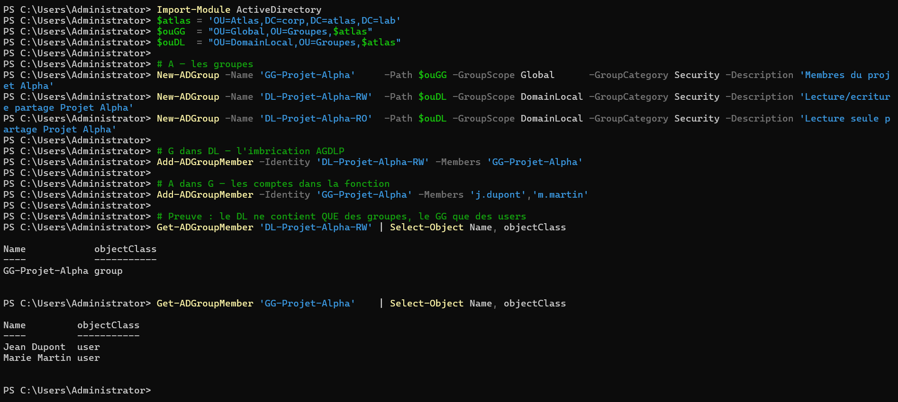

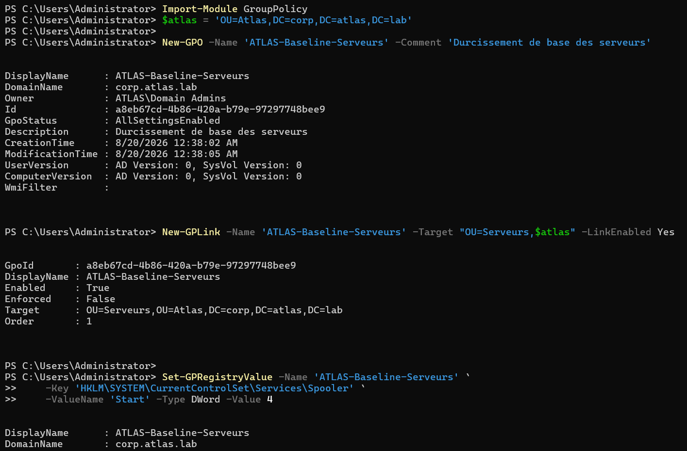

---

## Module 3 — Automatisation avec PowerShell

**Objectif.** Provisionner cinq cents comptes de façon fiable et reproductible, avec un module
PowerShell réutilisable.

Cinq cents identités sont générées, réparties par service selon des poids réalistes.

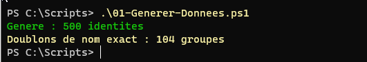

Le provisionnement est d'abord lancé en simulation : rien n'est créé, le script annonce seulement ce
qu'il ferait.

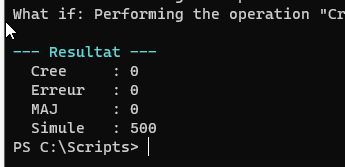

L'exécution réelle crée les comptes, les place dans leur OU et les ajoute à leur groupe.

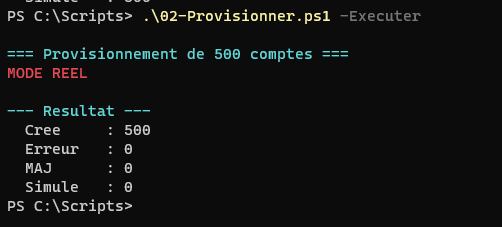

Preuve décisive de l'**idempotence** : relancé, le script ne crée aucun compte, met à jour les cinq
cents existants, sans erreur — comportement attendu d'un script tournant chaque jour sur un export
RH.

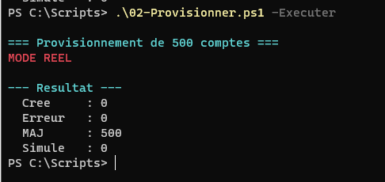

Chaque compte reçoit un dossier personnel dont les permissions sont posées par identifiant de
sécurité (SID), et non par nom de groupe.

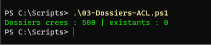

La vérification confirme que l'héritage est coupé : chaque utilisateur est isolé dans son dossier.

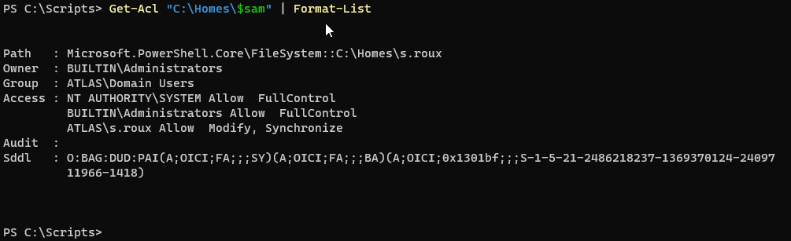

Un rapport d'audit consolide l'état des comptes.

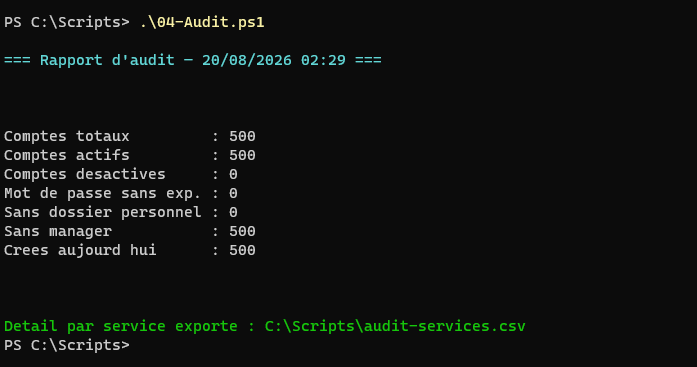

Les liens hiérarchiques sont posés, ce qui fait chuter le nombre de comptes « sans manager » aux
seuls responsables.

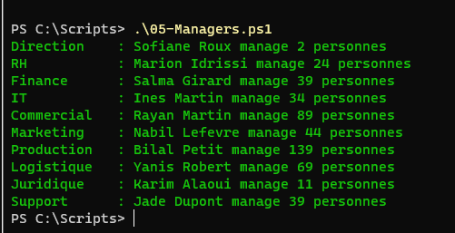

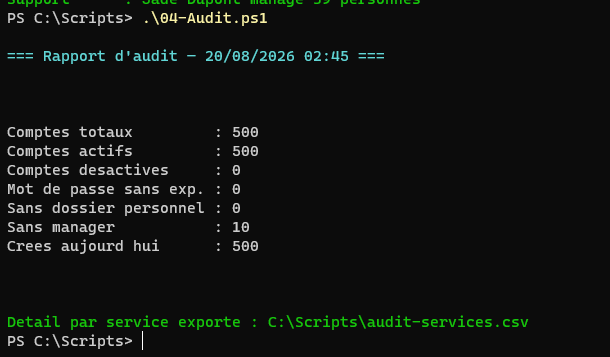

Le rapport est exporté en HTML, et le module validé — le test le plus important confirmant l'unicité
de tous les identifiants.

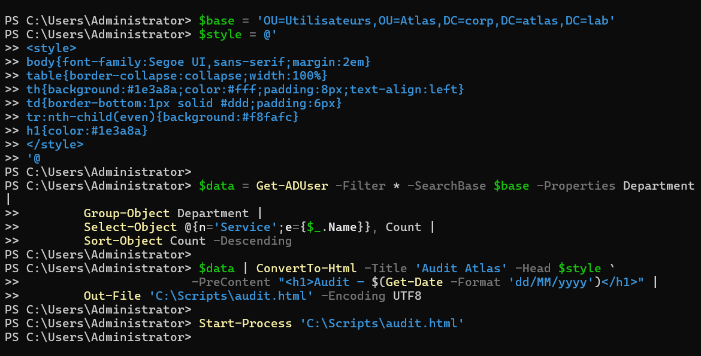

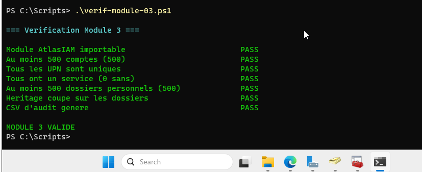

> **Difficulté centrale.** Le premier provisionnement n'a produit que **279 comptes sur 500** :
> l'identifiant de connexion (initiale + nom) n'était pas unique, et les homonymes s'écrasaient.
> La correction a consisté à introduire un **matricule** comme identifiant stable, comme le fait un
> système RH. L'identité ne se fonde pas sur le nom.
>
> Une autre difficulté : les permissions échouaient avec « identity could not be translated » car
> les groupes étaient nommés en français sur un serveur anglais. Les noms des groupes intégrés sont
> traduits selon la langue, mais pas leurs SID : on les résout donc toujours par leur SID.

---

## Module 4 — Résilience : réplication, FSMO, restauration

**Objectif.** Supprimer le point de défaillance unique : un second contrôleur, la réplication, les
rôles FSMO, la restauration après incident.

Un second serveur est promu comme réplica du domaine existant.

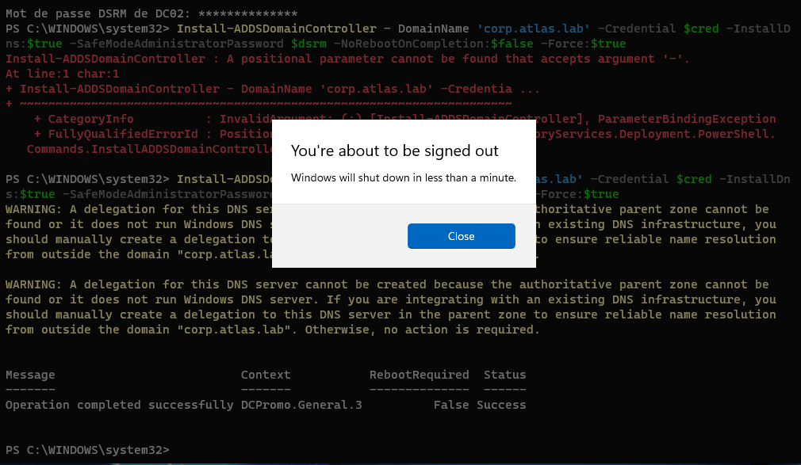

L'état de la réplication montre que les deux contrôleurs se voient, sans échec récent.

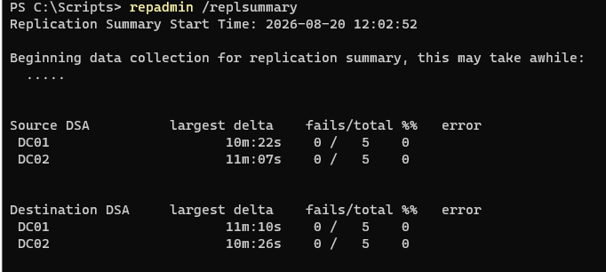

Démonstration : un objet créé sur un contrôleur apparaît sur l'autre — la réplication multi-maître
en action.

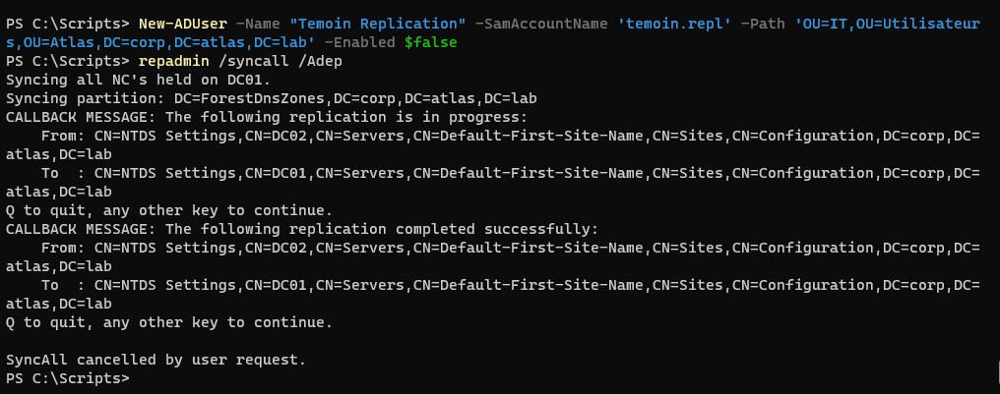

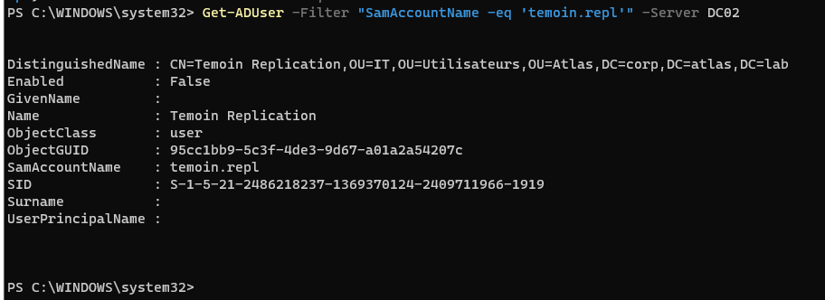

Les cinq rôles FSMO, portés par le premier contrôleur, gèrent les opérations qui n'admettent pas le
multi-maître.

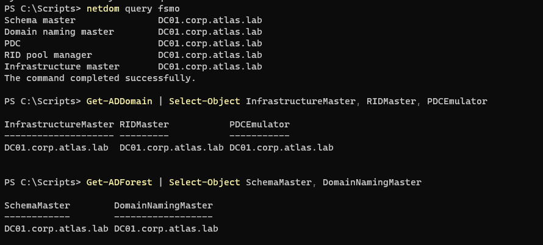

Le rôle d'émulateur de contrôleur principal est transféré vers DC02, puis ramené sur DC01.

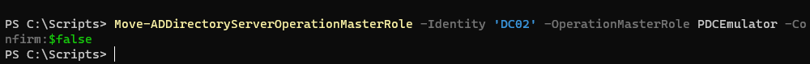

Une sauvegarde de l'état système est réalisée.

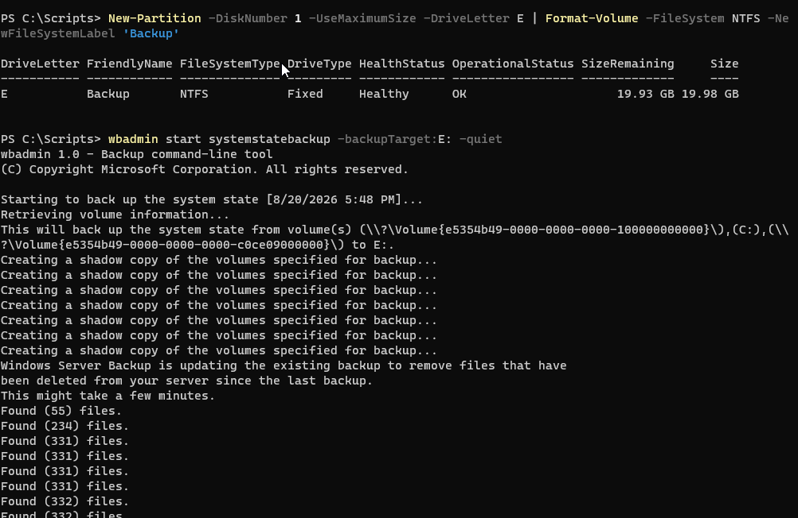

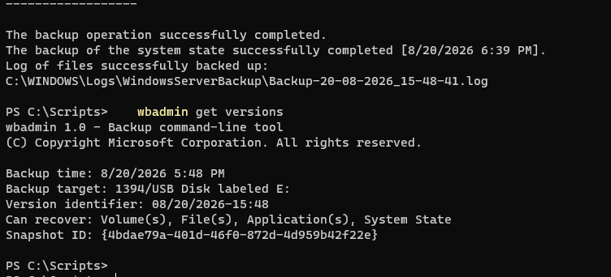

La Corbeille Active Directory est activée. Un scénario de désastre est provoqué — une OU entière
supprimée — puis récupérée d'une seule commande, sans redémarrage.

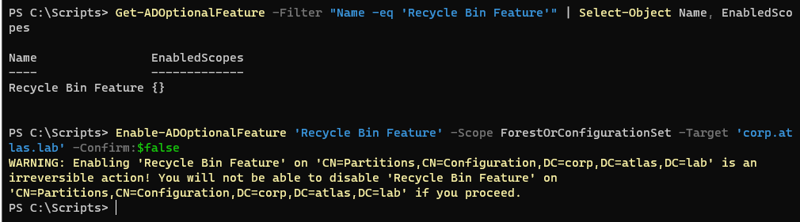

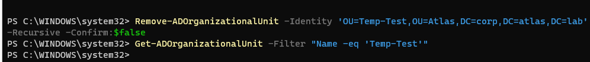

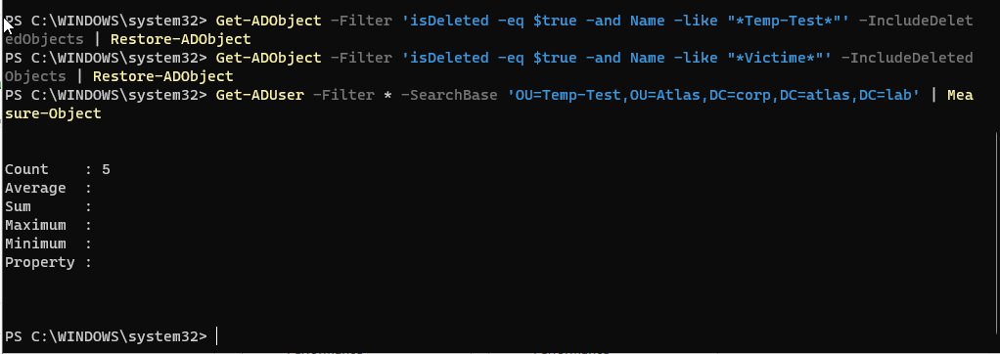

Le module est validé par dix contrôles.

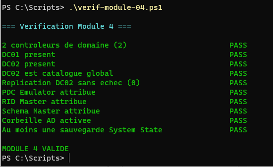

> **Difficultés rencontrées.**
> - La sauvegarde était refusée : Windows interdit d'écrire l'état système sur le volume système. Il
>   a fallu ajouter un disque dédié.
> - La restauration DSRM piège par sa mécanique : `bcdedit /set safeboot` force le démarrage en mode
>   restauration à chaque redémarrage, d'où un serveur bloqué en boucle, résolu par
>   `bcdedit /deletevalue safeboot`.
> - Le script signalait « un échec de réplication » : il s'agissait d'un échec **historique** au
>   démarrage de DC02, résolu depuis. Distinguer l'historique de l'état courant évite de traiter une
>   fausse alerte comme une panne.
>
> **À retenir.** La Corbeille AD doit être activée *avant* l'incident : elle ne récupère que les
> objets supprimés après son activation.

---

## Module 5 — Diagnostic : provoquer et réparer des pannes

**Objectif.** Provoquer dix pannes avec un script « saboteur » dissimulé, puis diagnostiquer à
l'aveugle et réparer. Méthode : l'heure, puis le DNS, puis les services, puis les droits.

Première panne : le service Netlogon est arrêté, empêchant la localisation des contrôleurs — puis
réparé.

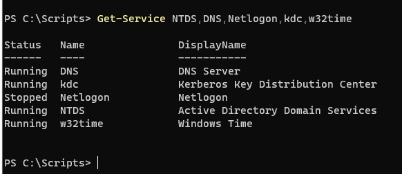

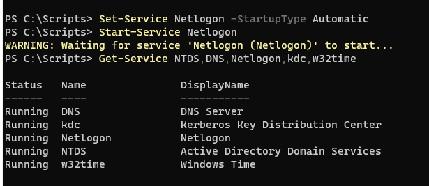

Une autre panne casse la résolution DNS.

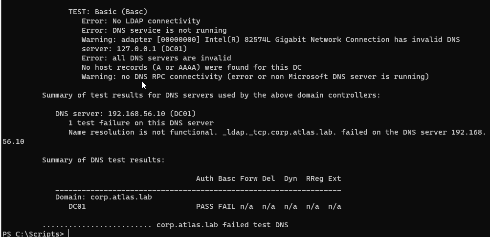

La cause est un enregistrement de localisation supprimé, republié en redémarrant Netlogon ; ou un
DNS repointé à tort vers un serveur externe, corrigé en le repointant sur le contrôleur.

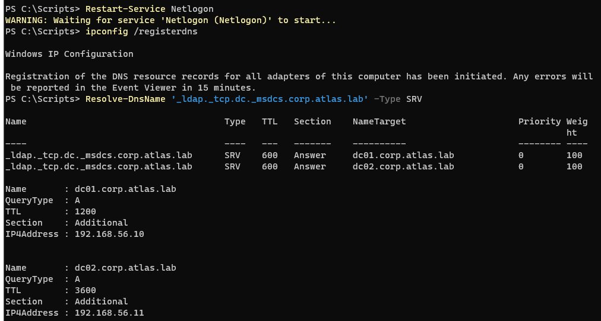

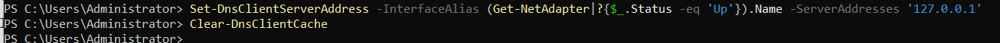

Autres réparations : le filtrage de sécurité d'une stratégie de groupe, une source de temps
invalide, et une règle de pare-feu bloquant le port LDAP.

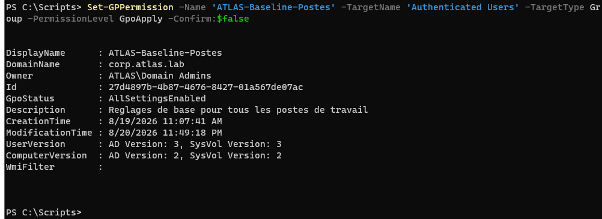

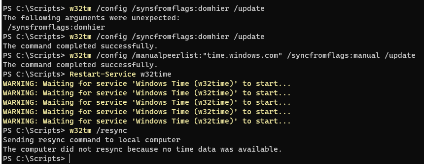

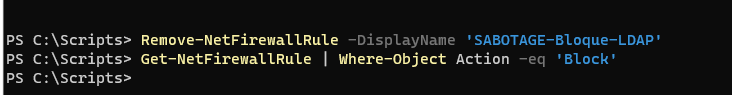

> **À retenir.** La plupart des pannes d'Active Directory sont des pannes DNS déguisées. La panne du
> pare-feu illustre l'importance de tester le **port** et non seulement le ping. Fait notable : la
> suppression d'un enregistrement de localisation n'a coupé aucun service, le second contrôleur
> assurant le relais — la démonstration concrète de l'intérêt de la redondance.

---

## Module 6 — Sécurité d'Active Directory

**Objectif.** Comprendre les attaques pour comprendre les défenses. Audit de la surface d'attaque,
protections modernes, cartographie des chemins d'attaque, durcissement.

On recherche les comptes porteurs d'un nom de service (candidats au Kerberoasting).


Vérification du cas le plus critique : aucun administrateur du domaine n'est Kerberoastable — cette
commande doit retourner vide.


Aucun compte n'a la pré-authentification Kerberos désactivée.


**LAPS** attribue à chaque machine un mot de passe administrateur local unique et tournant.


**Les comptes de service managés (gMSA)** ont un mot de passe de 240 caractères géré par l'annuaire,
connu de personne.


**Durcissement** : désactivation de SMBv1 et du service d'impression sur le contrôleur.


Le module est validé par sept contrôles.


BloodHound est déployé pour cartographier les chemins d'attaque.


> **À retenir.** Toutes les requêtes d'audit fonctionnent avec un compte standard : la
> reconnaissance de l'annuaire est gratuite pour tout attaquant. Un gMSA est la réponse définitive au
> Kerberoasting.
>
> **Difficulté rencontrée.** La collecte BloodHound a été bloquée par deux contrôles de sécurité : la
> signature LDAP obligatoire du contrôleur, puis la tolérance d'horloge Kerberos (5 minutes). Ces
> blocages démontrent que le domaine est correctement sécurisé.

---

## Module 7 — Gestion des identités (IAM) avec Keycloak

**Objectif.** L'identité moderne : OAuth 2.0, OpenID Connect, jetons, fédération. OAuth 2.0 est un
protocole d'**autorisation** ; c'est OpenID Connect, bâti au-dessus, qui apporte l'authentification.

Console d'administration de Keycloak, puis création d'un espace de travail dédié et d'une application
cliente OpenID Connect.


Un jeton d'accès est obtenu, puis décodé — sa charge utile se lit **sans aucune clé**.


Un JWT se compose de trois parties : en-tête, charge utile, signature.


Un rôle attribué apparaît dans le jeton d'accès. La comparaison des deux jetons est instructive :
l'`id_token` porte l'identité, l'`access_token` porte les droits.


La fédération connecte Keycloak à l'Active Directory, à l'aide d'un compte de service en lecture
seule ; une autorité de certification est installée pour activer LDAPS.


> **À retenir.** Un JWT n'est pas chiffré : il est seulement signé. On n'y place jamais de donnée
> sensible.
>
> **Difficultés rencontrées.**
> - Le rôle n'apparaissait pas d'abord dans le jeton : la requête utilisait le flux « client
>   credentials » (jeton du compte de service) au lieu du flux « password » (jeton de l'utilisateur).
>   Le flux détermine *qui* est authentifié.
> - La fédération en LDAP clair a été refusée par le contrôleur (signature LDAP obligatoire, comme
>   avec BloodHound). Une autorité de certification a été installée pour activer LDAPS. La fédération
>   de production se fait toujours en LDAPS.

---

## Module 8 — Gestion des accès à privilèges (PAM) avec Vault

**Objectif.** Le concept central du PAM moderne, le **secret dynamique** : au lieu de stocker un mot
de passe, Vault crée l'identifiant à la demande et le détruit après un délai.

Interface de Vault, écriture d'un secret statique, et versionnement.


Vault est connecté à une base PostgreSQL, puis génère un identifiant dynamique — un compte qui
n'existait pas une seconde auparavant.


Preuve directe : le compte créé par Vault existe réellement dans PostgreSQL ; après révocation, il
disparaît.


Une politique restreint l'accès : un jeton restreint accède au chemin autorisé, mais est refusé sur
un chemin interdit. L'authentification applicative se fait par un identifiant à usage unique.


> **À retenir.** Le secret dynamique change la nature du risque : un identifiant volé n'a de valeur
> que tant qu'il est valide. La révocation par préfixe invalide instantanément tous les identifiants
> dérivés.
>
> **Difficulté rencontrée.** La connexion à PostgreSQL échouait (« password authentication failed
> for user [password] ») : la chaîne de connexion était mal formée, le nom d'utilisateur omis. La
> correction a rétabli la forme `{{username}}:{{password}}`.

---

## Module 9 — Sécurité Cloud avec Azure et Entra ID

**Objectif.** Dans le cloud, le périmètre n'est plus le réseau mais l'identité. Le premier réflexe
de sécurité cloud est de poser une alerte de budget avant de créer la moindre ressource.

**Deux systèmes de rôles distincts** : les rôles Azure RBAC gouvernent les ressources, les rôles
Entra ID gouvernent l'annuaire. Un rôle est attribué au niveau du groupe de ressources — le plus bas
qui suffit.


Un coffre Key Vault est créé, et un secret y est lu. L'**identité managée** est l'équivalent Azure du
gMSA : une identité liée à une ressource, sans secret à stocker.


Un compte de secours (break-glass) exclu des politiques est créé, un audit des comptes est réalisé,
puis les ressources sont supprimées.


> **À retenir.** Être administrateur global ne donne aucun droit sur une machine virtuelle, et
> inversement. On crée pour apprendre, on supprime après : une ressource oubliée génère une facture.
>
> **Difficultés rencontrées.**
> - La création du coffre a été refusée car la région n'acceptait plus de nouveaux clients ; il a
>   fallu en changer.
> - Une erreur « MissingSubscriptionRegistration » a rappelé qu'un abonnement neuf n'active que les
>   services demandés : il fallait enregistrer le fournisseur Key Vault.
> - Le rapport d'inscription MFA a été refusé car le tenant n'est pas Premium : l'accès conditionnel,
>   PIM et les rapports MFA nécessitent une licence P1/P2 — un point de budget réel. L'essai Premium
>   basculant en abonnement payant après 30 jours, il n'a pas été activé.

---

## Module 10 — Projet transverse : le cycle de vie complet

**Objectif.** Relier toutes les briques : un fichier RH pilote la création, la mutation et la
désactivation des comptes, selon le cycle « Joiner – Mover – Leaver ».

Le fichier RH source contient un cas de chaque type. La synchronisation est d'abord lancée en
simulation, qui annonce un arrivant, une mutation et un départ.


Après exécution, on vérifie que les trois événements ont eu lieu : l'arrivant est créé, le muté a
changé de service, le partant est désactivé et mis en quarantaine.


**Le garde-fou.** Soumis à un export corrompu marquant 60 % des comptes comme partis, le script
refuse de continuer : aucune désactivation n'a lieu.


Un rapport de gouvernance est produit, et le module validé.


> **À retenir.** Dans le cycle de vie, la mutation est l'étape la plus souvent mal traitée
> (silencieuse) : la règle est de retirer les anciens droits avant d'ajouter les nouveaux. La valeur
> d'un système de provisionnement tient à sa capacité à ne pas faire de dégâts : le garde-fou empêche
> un export tronqué de couper l'accès à toute l'organisation. La désactivation à la source se propage
> aux systèmes fédérés — d'où l'intérêt d'une source de vérité unique.

---

## Audit final

L'audit de sécurité du domaine à l'issue du laboratoire :

| Indicateur | Valeur | Interprétation |
|---|---|---|
| Comptes actifs | 497 | Population provisionnée |
| **Domain Admins avec SPN** | **0** | Aucun compte privilégié Kerberoastable |
| Comptes Kerberoastables | 0 | Surface d'attaque propre |
| Mots de passe sans expiration | 0 | Conforme |
| Comptes sans matricule | 0 | Tous rattachés à la source RH |
| Comptes de service managés (gMSA) | 1 | Compte de service sans secret exploitable |
| Contrôleurs de domaine | 2 | Redondance active |
| Corbeille AD | Activée | Récupération possible |
| Sans manager | 9 | Les responsables de service (normal) |

Deux valeurs élevées méritent une lecture avertie : les comptes « dormants » sont nombreux car les
cinq cents comptes, créés par script, ne se sont jamais connectés ; les neuf « sans manager » sont
les responsables. Distinguer l'artefact du vrai problème est au cœur de l'analyse.

---

## Enseignements transverses

- **L'identité ne se fonde pas sur le nom** : un identifiant stable (matricule) est indispensable.
- **Un domaine est identifié par son SID, pas par son nom.**
- **La signature LDAP obligatoire** d'un domaine récent bloque les outils de reconnaissance ;
  rencontrée deux fois (BloodHound, Keycloak), elle impose la fédération en LDAPS.
- **La meilleure gestion de secret est celle qui n'a pas de secret** : gMSA, identité managée et
  secret dynamique reposent sur ce principe.
- **Un garde-fou** refusant d'agir sur un export anormal distingue un outil sûr d'un script dangereux.
- **Un écart chiffré n'est pas forcément une anomalie.**

---

## Contenu du dépôt

```
lab/
├── README.md            ce document
├── Scripts/             tous les scripts PowerShell (module AtlasIAM, provisionnement, audit…)
├── FichiersCSV/         données RH et exports de test
├── Rapport&Audit/       rapports d'audit (txt, csv, html)
├── figures/             captures d'écran (noms normalisés, utilisées dans ce README)
└── images/              captures d'écran originales
```

---

## Avertissement

Environnement de **laboratoire isolé**, conçu pour l'apprentissage. Il comporte volontairement des
configurations à ne jamais reproduire en production : mots de passe faibles, réseau sans filtrage,
comptes de test permissifs, et certaines protections temporairement relâchées pour la démonstration.
Aucune donnée réelle ni configuration d'entreprise n'y figure ; le domaine `corp.atlas.lab` n'existe
pas publiquement.
